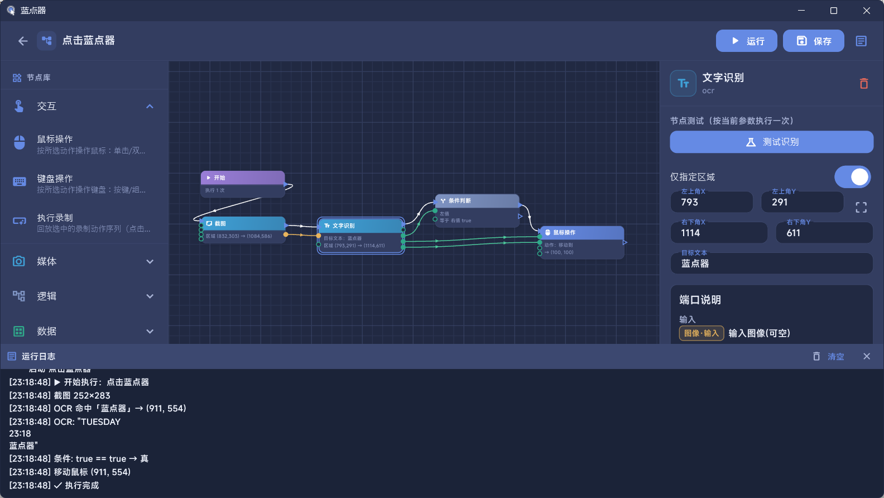
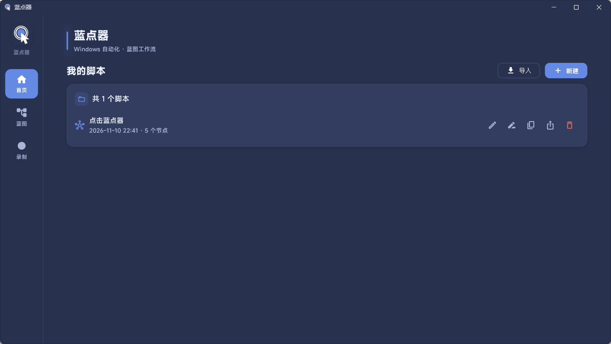
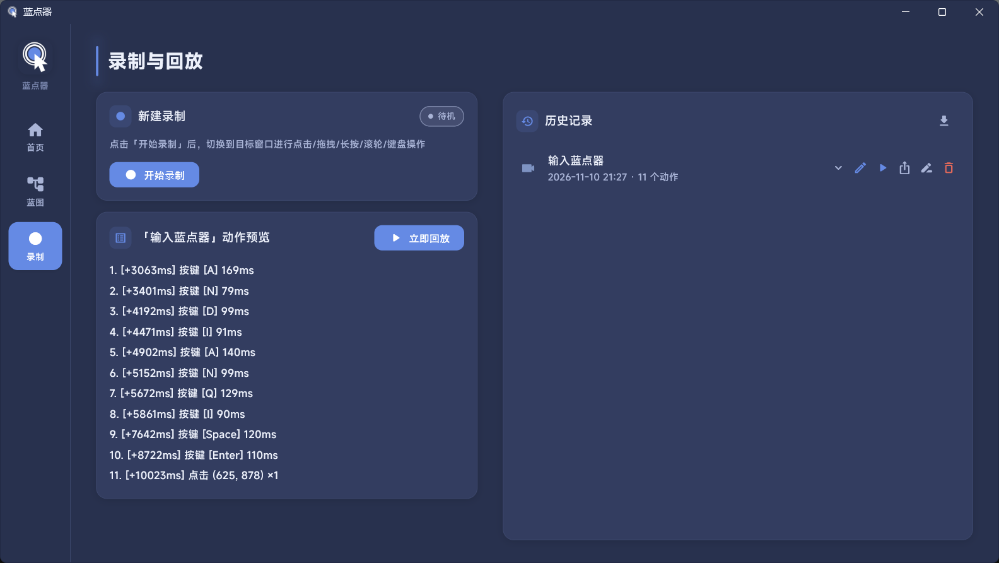

# 蓝点器 (BlueDot Clicker)

> Windows 桌面自动化工具 · 可视化蓝图工作流 · 离线 OCR / 图像识别 / 键鼠录制回放


[下载安装](#下载与安装) · [功能特性](#功能特性) · [快速开始](#快速开始) · [节点手册](#节点手册) · [已知问题](#已知问题与排查) · [开发与构建](#开发与构建) · [致谢](#第三方组件与致谢) · [许可证](#许可证)



## 简介

蓝点器是一款面向 Windows 的桌面自动化工具。它把鼠标、键盘、截图、OCR、图像识别、变量、条件与循环等能力封装成蓝图节点，让你通过拖拽和连线搭建自动化脚本，而不必编写代码。

典型用途：

- 游戏日常、重复点击、挂机流程
- 桌面软件批量操作
- 识别屏幕文字后点击、填写、保存
- 录制一段键鼠操作并在流程中回放
- 把识别结果写入文件或变量，做简单数据处理

脚本保存为 `.bpc.json`，也可以导出为 `.bpc.zip` 脚本包，连同引用的录制和模板图片一起分享给他人。

> 请勿将本工具用于违反游戏或软件服务条款、破坏公平性或涉及账号安全的场景。

## 功能特性

- **可视化蓝图**：节点库 + 画布 + 属性面板，执行流与数据流分离，连线直观。
- **丰富的交互节点**：鼠标单击/双击/拖拽/长按/滚轮/移动，键盘按键/组合键，支持左/右/中键。
- **键鼠录制回放**：全局录制鼠标与键盘动作，支持动作预览、编辑、立即回放，并可被蓝图中的「执行录制」节点调用。
- **离线 OCR**：内置 PaddleOCR PP-OCRv6 模型，支持中文、英文及 18000+ 字符，无需联网；识别在后台 isolate 执行，不阻塞界面。
- **图像识别**：基于 OpenCV 模板匹配，支持相似度阈值与区域限定；OpenCV 原生库不可用时自动回退纯 Dart 实现。
- **变量与运算**：设置/获取变量、加法、减法，支持条件判断与条件循环。
- **数据保存**：把识别文本保存为 `.txt`，把截图保存为 `.png`，同名文件自动加序号。
- **脚本包**：`.bpc.zip` 内嵌录制与模板，导入时自动处理重名、哈希校验与冲突重映射。
- **多屏与负坐标**：基于虚拟桌面坐标，支持副屏位于主屏左侧/上方时的负坐标截取与点击。
- **安全机制**：F10 全局停止、10 万步死循环保护、按键兜底释放、可中止延时、循环让出事件循环。

## 界面预览

| 首页                  | 录制与回放                               |
| ------------------- | ----------------------------------- |
|  |  |

## 下载与安装

### 下载

**[前往 GitHub Releases 下载最新安装包 →](https://github.com/2cytechie/BlueDotClicker/releases)**

- 安装包命名：`BlueDotClicker-Setup-<版本号>.exe`
- 当前版本：`26.11.14`
- 历史版本同样在 Releases 页面查看。

### 系统要求

| 项目   | 要求                           |
| ---- | ---------------------------- |
| 操作系统 | Windows 10 / Windows 11，64 位 |
| 处理器  | x64                          |
| 显卡   | 无特殊要求（OCR 与图像识别使用 CPU）       |
| 网络   | 安装后无需联网，OCR 模型已内置            |
| 权限   | 安装需要管理员权限；操作管理员窗口时建议以管理员身份运行 |

### 安装说明

1. 下载 `BlueDotClicker-Setup-<版本号>.exe`。
2. 双击运行，按向导完成安装。
3. 当前安装包未做代码签名，Windows SmartScreen 可能提示“已保护你的电脑”。点击“更多信息 → 仍要运行”即可。
4. 安装完成后从开始菜单或桌面图标启动。

## 快速开始

1. **新建脚本**：首页点击「新建」，输入脚本名称。
2. **添加节点**：从左侧节点库点击节点，节点会出现在画布中央。
3. **连接执行流**：从节点的白色执行流输出口拖到下一个节点的执行流输入口。
4. **连接数据流**：把识别结果的坐标、文本等绿色数据输出口拖到目标节点的数据输入口。
5. **配置参数**：选中节点，在右侧属性面板设置坐标、图片、阈值、延时等。
6. **运行**：点击右上角「运行」；运行中点击「停止」或按 **F10** 随时中止。

一个最简单的“识别后点击”流程：

```text
开始
 └→ 截图（区域：目标按钮附近）
      └→ 文字识别（目标文本：开始游戏）
           └→ 条件判断（左值←是否命中，比较方式：等于，右值：true）
                ├─ 真 → 鼠标单击（X←坐标X，Y←坐标Y）
                └─ 假 → 延时 500ms（可接回截图重试）
```

> 首次使用 OCR 时需要加载模型，第一次识别可能稍慢，之后会明显加快。

## 核心概念

### 执行流与数据流

| 连线   | 颜色  | 作用                   | 连接限制                      |
| ---- | --- | -------------------- | ------------------------- |
| 执行流  | 白色  | 决定节点按什么顺序执行          | 输入口允许多条入边；每个输出口最多 1 条出边 |
| 数据流  | 绿色  | 把值从一个节点的输出传给另一个节点的输入 | 数据输入口最多 1 条入边；数据输出口可接多个下游 |
| 图像数据 | 琥珀金 | 传递截图、模板等图像           | 只能连接图像类型端口                |

- 执行流从「开始」节点出发，线性执行；没有并行分支。
- 数据输入连接后，属性面板中对应参数会灰显锁定，但保留原值；运行时**数据边优先于常量参数**。
- 图像端口与普通数据端口有类型校验，图像不能连到文本/数字端口，反之亦然。

### 判断分支共用后续流程

把各分支末尾的执行输出连接到同一个节点的执行输入，即可共用后续流程，无需复制节点。也可以将判断的「真」「假」出口直接接到同一个执行输入口。

```text
条件判断 ─真→ 操作 A ─┐
                     ├→ 公共操作 C → 公共操作 D
         ─假→ 操作 B ─┘
```

- 每次判断只执行所选分支，再继续公共流程；汇合节点每次被实际到达时执行，不等待其他分支，也不自动去重。
- 循环体内的分支可以汇合，公共流程会每轮执行。仅在循环结束后执行的步骤应只接循环的「假」出口；若循环体和「假」出口都接到公共节点，该节点会在每轮及退出时分别执行。
- 汇合只共享执行流程，不会自动切换数据来源。公共节点不要依赖另一条未执行分支的识别结果；可在汇合后统一识别，或让每条分支为同名变量赋值，再通过「获取变量」读取，并检查结果是否有效。循环中未执行的数据源可能保留上一轮的端口值。
- 公共流程只有一套后续连线，不会执行完后返回各自分支。节点测试只验证本次实际到达目标的路径，应分别验证真、假分支。

### 变量与多轮执行

- 变量支持数字、字符串、布尔三种值。
- 「开始」节点的执行次数 `count` 大于 1 时，每轮开始会清空端口缓存和“最近截图”，但**变量表跨轮保留**，因此变量可以当累计器使用。
- 字面量自动推断：`true` / `false` → 布尔，整数 → int，小数 → double，其余按字符串。
- 读取变量用「获取变量」节点，它在下游消费数据时才读取当前值。
- 写入变量用「设置变量」节点；OCR、图像识别等节点只产出数据，不直接写变量。

### 图像传递

- 「截图」节点产出图像，并记录图像左上角对应的屏幕坐标。
- 识别节点取图优先级：**数据边 > 最近一次截图 > 现场截屏**。
- 区域裁剪按图像自身原点换算，支持副屏在主屏左侧/上方时的负坐标。

### 运行安全

| 机制       | 行为                           |
| -------- | ---------------------------- |
| F10 全局停止 | 运行期间轮询 F10，按下后立即停止；延时等待也会被打断 |
| 10 万步上限  | 单次链式执行超过 10 万步判定为死循环并终止      |
| 按键兜底释放   | 停止/异常时统一抬起未释放的组合键，避免卡住桌面     |
| 可中止延时    | 延时每 50ms 检查停止标志              |
| 循环让出     | 循环每轮结束让出事件循环，界面和 F10 保持响应    |
| 未知节点     | 执行流中断，避免用错误语义继续操作            |

## 节点手册

### 节点总览

| 节点   | 类型 key          | 分类 | 执行流                   | 数据输入                            | 数据输出                    |
| ---- | --------------- | -- | --------------------- | ------------------------------- | ----------------------- |
| 开始   | `start`         | 脚本 | 无入 / `out` 出          | —                               | —                       |
| 鼠标操作 | `mouse`         | 交互 | `in` / `out`          | `x`、`y`（拖拽时复用为起点）、`endX`、`endY` | —                       |
| 键盘操作 | `keyboard`      | 交互 | `in` / `out`          | —                               | —                       |
| 执行录制 | `playRecording` | 交互 | `in` / `out`          | —                               | `success`               |
| 截图   | `screenshot`    | 媒体 | `in` / `out`          | `left`、`top`、`right`、`bottom`   | `imageOut`              |
| 文字识别 | `ocr`           | 媒体 | `in` / `out`          | `image`、`targetText`            | `text`、`found`、`x`、`y`  |
| 图像识别 | `imageMatch`    | 媒体 | `in` / `out`          | `image`                         | `found`、`x`、`y`、`score` |
| 条件判断 | `condition`     | 逻辑 | `in` / `true`、`false` | `left`、`right`                  | —                       |
| 循环   | `loop`          | 逻辑 | `in` / `true`、`false` | `left`、`right`                  | —                       |
| 延时   | `delay`         | 逻辑 | `in` / `out`          | —                               | —                       |
| 设置变量 | `setVar`        | 数据 | `in` / `out`          | `value`                         | `valueOut`              |
| 获取变量 | `getVar`        | 数据 | 无（纯数据节点）              | —                               | `value`                 |
| 加法   | `add`           | 数据 | `in` / `out`          | `a`、`b`                         | `result`                |
| 减法   | `subtract`      | 数据 | `in` / `out`          | `a`、`b`                         | `result`                |
| 数据保存 | `saveData`      | 数据 | `in` / `out`          | `text`、`image`                  | `textOut`、`imageOut`    |

> 规划中的「文本输入」节点见 [规划中的节点](#规划中的节点)。

### 规划中的节点

#### 文本输入（`textInput`，规划中）

> 该节点尚未在当前版本中提供。以下为设计草案，最终参数与行为以实际实现为准。

**目标**：向当前前台窗口的输入框键入一段文字。相比「键盘操作」只能发送单个虚拟键，文本输入节点可以直接输入任意文本，包括中文、英文、符号和换行。

## 已知问题与排查

> OCR 已切换为 PaddleOCR PP-OCRv6，常规界面文字的识别正确率已明显提升。以下情况仍可能导致识别失败或图像识别不准。

### OCR 识别不准 / 识别不到文字

| 现象      | 可能原因              | 处理方式                        |
| ------- | ----------------- | --------------------------- |
| 文字识别为空  | 区域内没有文字、文字太小、对比度低 | 用「框选区域」只框住文字；放大游戏/软件 UI 或字体 |
| 中文/英文漏字 | 艺术字、描边、阴影、半透明背景   | 换更清晰的界面；避免文字与背景颜色接近         |
| 目标文本找不到 | 目标文本与识别结果不完全一致    | 用「测试识别」查看实际文本；只填关键词，不要带多余空格 |
| 坐标是 -1  | 未命中目标文本           | 先判断 `found`；确认区域包含目标文字      |
| 第一次识别很慢 | OCR 模型首次加载        | 等待首次加载完成；后续识别会加快            |
| OCR 卡顿  | 识别区域过大或循环内无延时     | 缩小区域；在循环体内加 200\~500ms 延时   |

### 图像识别不准 / 点错位置

| 现象          | 可能原因                | 处理方式                       |
| ----------- | ------------------- | -------------------------- |
| 相似度很高但没命中   | 阈值设置过高              | 适当降低 `threshold`（如 0.75）   |
| 相似度低但确实是目标  | 模板与当前画面缩放/DPI 不一致   | 用当前分辨率重新截图做模板；保持游戏分辨率与缩放不变 |
| 命中到相似元素     | 模板缺少区分度             | 截取更有辨识度的局部；缩小识别区域          |
| 分数忽高忽低      | 目标有动画、呼吸效果、半透明      | 选静态帧做模板；或改用 OCR 识别文字       |
| 永远不命中       | 模板比识别区域大            | 缩小模板或扩大区域                  |
| 未命中却点到了奇怪位置 | 把未命中的 `x/y` 直接连给了鼠标 | 先用条件判断 `found`，再决定是否点击     |

### 点击 / 按键没有反应

- **权限问题**：普通权限程序无法向管理员窗口发送输入（Windows UIPI 限制）。请以管理员身份运行蓝点器。
- **独占全屏游戏**：部分游戏会拦截 SendInput 或 GDI 截屏。尝试窗口化/无边框窗口模式。
- **反作弊**：部分网游会拦截模拟输入。请勿在违反游戏条款的场景使用。
- **坐标问题**：确认目标坐标是屏幕物理像素；多屏环境下注意负坐标。
- **焦点问题**：键盘输入前先用鼠标点击目标窗口，确保它处于前台。

### 安装与启动

- 安装包未签名，SmartScreen 提示属于正常现象；确认来源后可选择“仍要运行”。
- 安装需要管理员权限。
- 仅支持 Windows 10/11 64 位；不支持 Windows 7/8、32 位系统、macOS、Linux、Android。
- 如果安装包无法运行，检查是否被安全软件拦截，或将安装包复制到桌面后重试。

### 数据保存在哪里

| 数据       | 位置                                 |
| -------- | ---------------------------------- |
| 脚本       | `我的文档\bluedot_clicker\scripts\`    |
| 录制       | `我的文档\bluedot_clicker\recordings\` |
| 模板图片     | `我的文档\bluedot_clicker\templates\`  |
| 数据保存节点输出 | `我的文档\bluedot_clicker\save\`       |
| OCR 模型   | 应用支持目录（首次运行自动释放）                   |

> 卸载应用不会自动删除上述用户数据；需要彻底清理时请手动删除 `我的文档\bluedot_clicker\`。

「图像识别」节点选择图片后，会自动将副本保存到上述模板图片目录，按内容哈希命名并去重；删除或移动外部原图不会影响已选模板。旧蓝图中的外部图片路径仍可使用，重新选择图片后会保存副本。

## 开发与构建

### 环境要求

| 工具            | 要求                           |
| ------------- | ---------------------------- |
| Flutter       | 3.x（Dart SDK `^3.10.4`）      |
| Visual Studio | 2022，安装“使用 C++ 的桌面开发”工作负载    |
| Windows SDK   | Windows 10 SDK 或更高           |
| OpenCV        | 4.x（pp\_ocr 的 Windows 原生库需要） |
| Inno Setup    | 6.x（仅打包安装包时需要）               |

### 初始化

```powershell
flutter pub get

# 下载并解压 OpenCV 4.13 到 third_party/opencv
powershell -ExecutionPolicy Bypass -File tool/setup_opencv.ps1
```

也可以自行安装 OpenCV 4.x，并设置环境变量 `OpenCV_DIR` 指向其 `build` 目录。

PP-OCRv6 模型已随 `assets/ocr/ppocr_v6/` 提供，无需额外下载。

### 运行与测试

```powershell
flutter run -d windows
flutter analyze
flutter test
```

### 打包

```powershell
flutter build windows --release
ISCC.exe windows\installer\bluedot_clicker.iss
```

安装包输出到 `dist\BlueDotClicker-Setup-<版本号>.exe`。版本号需同时修改 `pubspec.yaml` 和 `windows/installer/bluedot_clicker.iss`。

### 项目结构

```text
lib/
├─ core/         主题、颜色、字体等基础样式
├─ engine/       蓝图解释执行引擎、变量与比较
├─ models/       脚本模型、节点定义、键位表
├─ platform/     Win32 FFI、截屏、鼠标键盘、录制、坐标/区域拾取
├─ services/     OCR、模板匹配、脚本存储、脚本包、文件保存
├─ state/        Riverpod 状态与运行器
└─ ui/           首页、蓝图编辑器、属性面板、录制页
assets/ocr/ppocr_v6/   PP-OCRv6 det/rec 模型与字典
windows/installer/     Inno Setup 安装脚本
tool/setup_opencv.ps1  OpenCV 依赖安装脚本
```

## 第三方组件与致谢

本项目使用了以下开源组件，感谢作者们的贡献：

| 组件                                                                     | 用途                | 许可证          |
| ---------------------------------------------------------------------- | ----------------- | ------------ |
| [fl\_nodes\_v2](https://github.com/ConnectingTheDots-DCWK/fl_nodes_v2) | 蓝图节点编辑器画布         | MIT          |
| [pp\_ocr](https://github.com/ubuntu2204/paddle_ocr)                    | Windows 离线 OCR 插件 | MIT          |
| [PaddleOCR PP-OCRv6](https://github.com/PaddlePaddle/PaddleOCR)        | OCR 检测/识别模型       | Apache-2.0   |
| [ONNX Runtime](https://github.com/microsoft/onnxruntime)               | OCR 模型推理          | MIT          |
| [OpenCV](https://opencv.org/)                                          | 模板匹配与图像处理         | Apache-2.0   |
| [Flutter](https://flutter.dev/)                                        | 跨平台 UI 框架         | BSD-3-Clause |
| MiSans                                                                 | 界面字体（小米，免费商用）     | 小米字体许可       |

特别感谢 [fl\_nodes\_v2](https://github.com/ConnectingTheDots-DCWK/fl_nodes_v2)：本项目的蓝图画布、节点拖拽与连线交互基于该项目实现。

完整的第三方版权与许可信息见 [NOTICE](NOTICE)。

## 许可证

本项目以 **GNU General Public License v3.0（GPL-3.0）** 发布。

- 你可以自由使用、修改、分发本项目。
- 如果你分发修改后的版本，必须以 GPL-3.0 同样开源，并提供完整的对应源代码。
- 允许商业使用，但不提供任何担保。
- 第三方组件遵循其各自许可证，详见 [NOTICE](NOTICE)。

完整条款见 [LICENSE](LICENSE)，或访问 <https://www.gnu.org/licenses/gpl-3.0.html>。

## 贡献

欢迎提交 Issue 和 Pull Request。

- 提交前请先运行 `flutter analyze` 和 `flutter test`。
- 保持脚本格式 `.bpc.json` 向后兼容；新增节点请同步更新本文档。
- 报告问题时请附上：Windows 版本、目标软件/游戏名称、脚本节点截图、运行日志、复现步骤。
